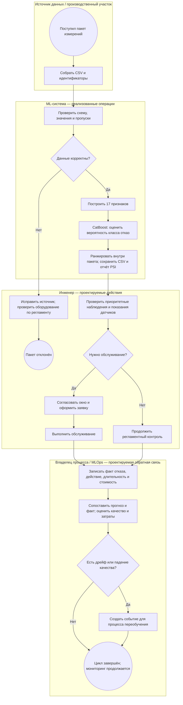

# Место модели в процессе обслуживания оборудования

**Автор: Яньшин А.** Учебная доработка группового проекта, ветка `yanshin`.

## Назначение и границы

Бизнес-задача — помочь инженеру распределять ограниченное время на проверки
оборудования, уменьшать внеплановые простои и лишние выезды. Модель ранжирует
наблюдения по оценке отказа; инженер проверяет причины и принимает решение.
Регламентное обслуживание и аварийная защита действуют независимо от модели.

Это **проектируемый бизнес-процесс**. В репозитории реализованы пакетная загрузка
CSV, ETL, CatBoost, выдача оценок и отчётов. Получение телеметрии с реальных
станков, система заявок на ремонт и измерение экономического эффекта пока не
интегрированы. Используемый baseline видит флаги отказов, поэтому годится для
учебной классификации состояния, но ещё не доказывает возможность раннего
предупреждения. Условия перехода к пилоту — в [карточке модели](model_card.md#условия-допуска-к-пилоту-и-эксплуатации).

## Схема

Схема в Markdown использует логику BPMN: событие, задачи, исключающие шлюзы,
дорожки участников. Это обзор процесса, а не исполняемый BPMN-файл.

## Что происходит на каждом этапе

| Этап | Вход | Результат и использование | Статус / код |
| --- | --- | --- | --- |
| Сбор | Показания и сведения об изделии | Пакет для проверки | Сейчас локальные `keis7-main/*.csv`; промышленный сбор проектируется |
| Проверка | `id`, `Product ID`, `Type`, 5 датчиков, 5 флагов | Корректный пакет или понятная ошибка | `src/etl/load.py` |
| Признаки | Корректный пакет | Матрица из 17 признаков, 6 категориальных | `src/etl/features.py`, `src/config.py` |
| Модель | Матрица и `model.cbm` | `failure_probability` для каждой строки | `src/predict.py` |
| Приоритеты | Оценки в одном пакете | `risk_level`, CSV с рекомендациями | `src/predict.py`; квантильная политика, не порог безопасности |
| Решение | Приоритеты, регламент, осмотр | Заявка или продолжение наблюдения | Действие инженера, интеграции с ремонтной системой нет |
| Обратная связь | Реальные отказы и действия | Размеченные наблюдения, KPI, сигнал на переобучение | Проектируется; текущий PSI сравнивает train/test |

Входные датчики: температура воздуха и процесса (K), обороты (rpm), крутящий
момент (Nm), износ инструмента (min). `Type` принимает L/M/H. Флаги TWF/HDF/PWF/OSF/RNF
описывают режимы отказа и создают утечку для задачи прогноза *до* события.
В рабочем пилоте их доступность проверяется; для раннего предупреждения они
исключаются вместе с зависимым счётчиком. `Product ID` в синтетических данных
нельзя без проверки считать идентификатором физического станка.

## Почему здесь имеет смысл исследовать ML

Износ, температура, обороты и нагрузка взаимодействуют нелинейно. CatBoost
может учитывать сочетания факторов и категориальные признаки, помогая
ранжировать большой объём наблюдений. Проверяемая гипотеза: при одинаковом
лимите проверок инженера модель обнаружит больше отказов, чем календарный
план или простое правило по износу. Это гипотеза пилота, а не доказанный эффект.

Сравнивать нужно на одинаковых данных, без флагов будущего события, с правилом
по износу и с простым baseline. Если правило даёт сопоставимый результат при
меньших затратах, усложнение ML-моделью не обосновано.

## Как результат превращается в бизнес-эффект

| Технический показатель | Практический смысл | Что измерять в пилоте |
| --- | --- | --- |
| Recall | Доля обнаруженных отказов | Пропущенные отказы и часы незапланированного простоя |
| Precision | Доля полезных тревог | Лишние осмотры, загрузка инженеров, стоимость ложных тревог |
| ROC-AUC | Качество ранжирования | Полезно для сравнения моделей, само по себе не равно экономии |
| Калибровка | Соответствие оценок частоте события | Возможность выбирать порог по стоимости решений |
| PSI | Изменение входных распределений | Повод проверить источник и качество на новых размеченных данных |

На исторической валидации при пороге 0.5: TP=371, FP=967, FN=59, TN=25 826.
Значит, среди 1 338 положительных решений 967 ложных. Эти бинарные решения
нельзя путать с квантильной категорией «Высокий» в инференсе.

Для утверждения порога владелец процесса задаёт стоимость пропуска `C_FN`,
ложной проверки `C_FP`, лимит проверок и затраты сопровождения. Упрощённая
оценка потерь: `L = FN × C_FN + FP × C_FP + затраты системы`.
Эффект пилота — разница затрат базового процесса и процесса с моделью на
сопоставимом периоде, с учётом стоимости внедрения. Реальные цены, длительности
простоя и эффект вмешательств отсутствуют, поэтому денежный ROI не заявляется.

Участие инженера необходимо: модель не видит всей производственной ситуации,
пропуск может привести к простою, а лишняя остановка тоже имеет стоимость.
Решение, время, версия модели и подтверждённый исход должны сохраняться для аудита.

Следующий процесс: [автоматическое переобучение](Model_retrain_BPMN.md).
