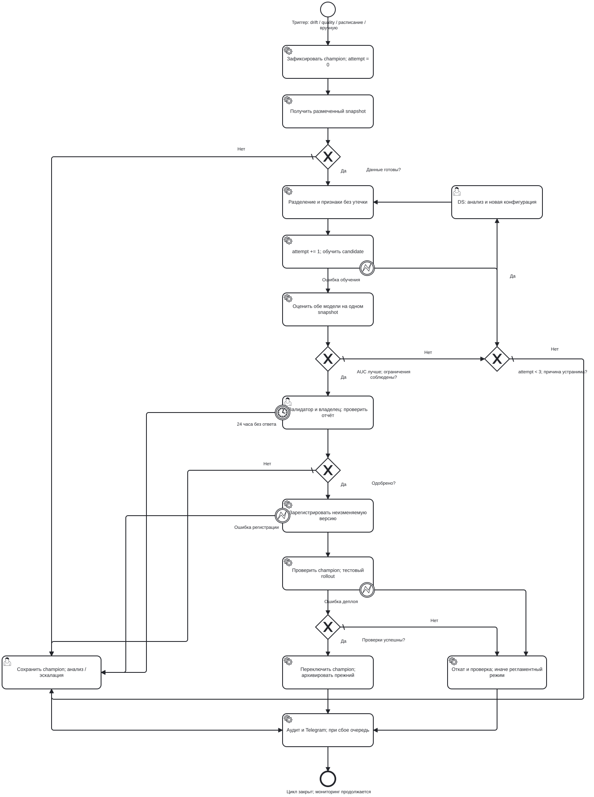
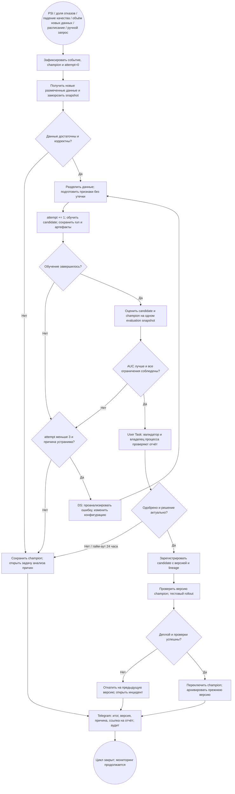

# Процесс переобучения модели

**Автор: Яньшин А.** Учебная доработка группового проекта, ветка `yanshin`.

## Статус решения

Это проект процесса для домашнего задания 3. Сейчас код умеет загружать данные,
обучать CatBoost, сохранять модель и метрики в MLflow Tracking, выполнять
инференс и рассчитывать PSI. Автоматический планировщик, Model Registry,
форма согласования, промышленный деплой и Telegram-интеграция **не реализованы**.
Tracking экспериментов не равнозначен регистрации версии для эксплуатации.

Редактируемая схема BPMN 2.0: [retraining-yanshin.bpmn](docs/bpmn/retraining-yanshin.bpmn).
[Векторное изображение схемы](docs/bpmn/retraining-yanshin.svg) — оно же встроено ниже.
Открыть через **Open diagram** в [bpmn.io](https://demo.bpmn.io/).
`isExecutable=false`: схема описывает требования, не запускает обучение или уведомления.
Ниже — та же схема в нотации BPMN и её обзор в Mermaid для чтения на GitHub.

## Схема

## Триггеры и предпосылки

Это **предлагаемые стартовые настройки учебного процесса**, требующие проверки
на реальных данных и согласования с владельцем процесса.

- **Data drift:** PSI ≥ 0.25 хотя бы одного датчика в двух последовательных
  непересекающихся суточных окнах минимум по 1 000 наблюдений. Reference фиксируется
  вместе с champion. PSI 0.1–0.25 — предупреждение и анализ источника.
- **Quality decay:** recall ниже 0.80 на новых наблюдениях с подтверждённым
  исходом и не менее 100 отказов. При меньшем числе отказов — сбор данных и
  ручная оценка неопределённости, без автоматического вывода об ухудшении.
- **Concept drift по доле отказов:** доля подтверждённых отказов в окне 30 суток
  отличается от доли в reference champion более чем в 1.5 раза в любую сторону,
  при не менее 100 подтверждённых отказах в окне. Для текущего baseline
  reference — 1.58%. Это сдвиг целевого признака, который PSI по датчикам не видит;
  изменение самой зависимости признаков и отказа проявляется как quality decay.
  Сигнал требует проверки разметки и состава парка до обучения.
- **Объём новых данных:** накоплено новых размеченных наблюдений не меньше,
  чем в обучающей выборке champion, и не менее 100 новых подтверждённых отказов.
  Плановое переобучение запускается и без дрейфа: новых данных достаточно, чтобы
  кандидат мог превзойти champion. Проверка выполняется при ежемесячном расписании.
- **Расписание:** ежемесячная проверка готовности данных; отсутствие новых
  подтверждённых меток не разрешает обучение на собственных предсказаниях.
- **Ручной запрос:** исправление данных, изменение парка или требований;
  инициатор и основание сохраняются.

PSI не измеряет concept drift, поэтому доля отказов отслеживается отдельным
триггером. Сигнал сначала требует проверки источника,
единиц измерения и состава парка. Ошибка датчика или ETL исправляется у источника.
Повторные события объединяются по `model_id + data_snapshot_id`; одновременно
работает один цикл для модели. После трёх неудачных попыток новые автоматические
события блокируются до решения ответственного специалиста.

## Этапы и передаваемые результаты

| Этап | Что выполняется | Выход следующему этапу / ответственность |
| --- | --- | --- |
| 1. Регистрация триггера | Проверка причины, блокировка параллельного цикла, фиксация исходной версии | `process_id`, trigger, champion version, attempt=0; MLOps |
| 2. Получение данных | Новая телеметрия и подтверждённые исходы; версии, контрольные суммы, доступность меток | Неизменяемый snapshot и отчёт качества; Data Engineer |
| 3. Подготовка | Проверка схемы, диапазонов, дублей и меток; временное разделение train/validation/evaluation, признаки только из доступного прошлого | Версия схемы и три непересекающиеся выборки; DS |
| 4. Обучение | Увеличение attempt до запуска, обучение candidate, early stopping только по validation | Модель, параметры, код, lock-хеш, run ID, лог; DS / service task |
| 5. Сравнение | Прогнозы обеих моделей на одном evaluation snapshot, AUC, recall, precision, ошибки и срезы | Отчёт сравнения и результат автоматических условий; service task |
| 6. Согласование | Проверка утечки, качества, нагрузки проверок, стоимости ошибок и применимости | Подписанное решение, комментарий, автор, время, версия отчёта; validator и business owner |
| 7. Регистрация | Неизменяемая версия candidate, ссылки на данные и run, Model Card и решение | Version ID и артефакт для развёртывания; MLOps |
| 8. Деплой | Проверка неизменности champion, smoke/совместимость, ограниченный rollout, наблюдение | Отчёт внедрения; при успехе переключение champion, при сбое откат |
| 9. Завершение | Итоговый аудит и уведомление Telegram, освобождение блокировки | Статус deployed / rejected / failed / rolled_back и ссылка на отчёт |

Для реального раннего предупреждения сначала нужны временные метки,
надёжный идентификатор оборудования и горизонт события. Флаги отказа и
`total_failures_cum` из текущего baseline исключаются или заменяются причинно
доступной историей. Текущее случайное разбиение из `src/train.py` не реализует
этот будущий временной протокол. Первая версия нового контракта проходит
отдельное ручное утверждение; сравнивать несовместимые цели как один AUC нельзя.

## «Аукцион по AUC»: условия допуска

При одинаковой задаче, горизонте и выборке выигрывает candidate, только если
одновременно выполнены условия:

1. `AUC_candidate ≥ 0.90` и `AUC_candidate − AUC_champion ≥ 0.005`.
2. На парных bootstrap-повторах по оборудованию нижняя 95% граница разницы
   AUC больше нуля. Если группировки/достаточного числа событий нет, автоматического допуска нет.
3. Recall candidate при **заранее выбранном на validation** пороге ≥ 0.80 и
   не ниже recall champion более чем на 0.02. Проверяются также L/M/H и отказы
   без флагов; малые подгруппы рассматривает валидатор.
4. Стоимость ошибок не выше champion и число проверок не превышает лимит
   инженеров. Пока `C_FN`, `C_FP` и лимит не согласованы, публикация блокируется.
5. Пройдены тесты данных, отсутствие утечки, совместимость входов/выходов,
   ограничения памяти и времени. SLA для оборудования согласуется до пилота.

Числа 0.90, 0.005, 0.80 и 0.02 — проектные допущения, не универсальные нормы
и не уже действующие проверки в коде. AUC 0.9701 из исторической карточки
не является доказательством допуска: там есть утечка и early stopping на валидации.
Evaluation не используется для подбора порога или параметров. Повторные
попытки требуют свежего evaluation snapshot либо отдельного финального
отложенного теста, иначе возникает подгонка к проверочной выборке.

## Неуспешные ветки, человек и откат

- Недостаточно данных, нет обоих классов, нарушена схема или источник неисправен:
  цикл закрывается, champion остаётся, создаётся задача сбора/исправления.
- Обучение упало или candidate не лучше: сохраняются run и причина;
  DS меняет обоснованную конфигурацию. Всего максимум **3 попытки**, включая первую.
  При отсутствии новых данных/гипотезы повтор запрещён.
- Валидатор отклонил или не ответил за **24 часа**: эскалация владельцу,
  цикл закрывается без публикации. Молчание не означает одобрение.
- Ошибка регистрации: champion сохраняется, процесс завершается как failed.
  Артефакт кандидата и журнал остаются для анализа.
- Champion изменился после согласования: деплой блокируется, требуется новое
  сравнение и согласование; старое решение не применяется к другой паре версий.
- Деплой или контроль после переключения не прошёл: восстановление предыдущей
  версии и проверка её работоспособности. Если откат неуспешен — остановка
  выдачи ML-рекомендаций и переход к регламентному процессу, эскалация инженеру.
- Telegram недоступен: результат деплоя не переигрывается; уведомление сохраняется
  в очереди с ограниченными повторами и эскалацией через журнал/дежурного.
  Секрет бота хранится в секретах окружения, данные наблюдений в сообщение не включаются.

Человек проверяет то, что не выражается одной метрикой: доступность признаков
до отказа, причины смещения, применимость к парку и допустимые затраты простоя.
В аудите сохраняются `process_id`, `run_id`, версии данных/модели/кода/окружения,
порог, отчёт, инициатор, решения, timestamps и предыдущий champion для отката.

Основание: лекция 4 (ModelOps, слайды 16–22 и 31–33), лекция 5
(слайды 14–23 и 35), пояснения вебинара 5 (50:41–53:07 — четыре вида триггеров, 53:38–61:10
и 83:04–86:46).
Связанные документы: [Model Card](model_card.md), [бизнес-процесс](Model_BPMN.md).
