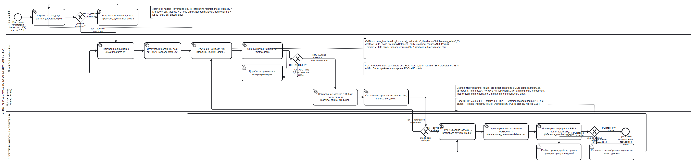
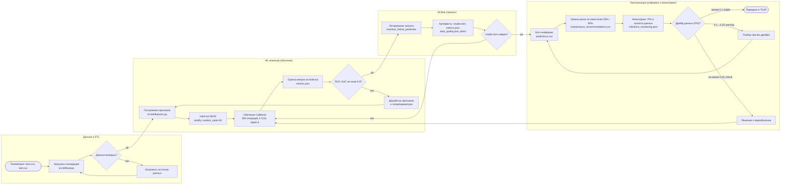
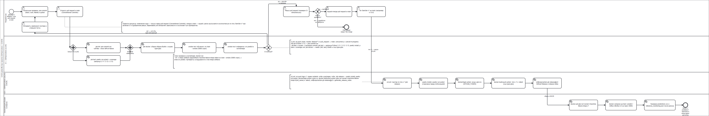

# BPMN 2.0 — модели процессов MLOps-проекта

Нотация: **BPMN 2.0** (OMG). В папке лежат две диаграммы, описывающие процессы,
фактически реализованные в репозитории: жизненный цикл ML-модели и выпуск релиза
через CI/CD. Каждый элемент схемы трассируется на код, конфиг или workflow
(таблицы в разделе «Трассировка»).

| Файл | Процесс | Полосы (роли) |
|------|---------|----------------|
| [`mlops-lifecycle.bpmn`](mlops-lifecycle.bpmn) | Жизненный цикл ML-модели: данные → признаки → обучение → MLflow → инференс → мониторинг дрейфа | Данные и ETL · ML-инженер · MLflow · Эксплуатация |
| [`ci-cd-release.bpmn`](ci-cd-release.bpmn) | CI/CD-релиз: pull request → CI → ревью → тег `v*` → GHCR → GitHub Release → развёртывание | Разработчик · CI · CD · Эксплуатация |

Растровые превью (сгенерированы из `.bpmn` командой `bpmn-to-image`):
[`mlops-lifecycle.png`](mlops-lifecycle.png) (3400×800) и
[`ci-cd-release.png`](ci-cd-release.png) (5480×900).

## Как открыть и экспортировать

| Инструмент | Действие |
|------------|----------|
| [demo.bpmn.io](https://demo.bpmn.io/) | перетащить `.bpmn` в окно браузера и нажать «Download» для сохранения |
| Camunda Modeler | `File → Open File…`, экспорт — `File → Export As → PNG / SVG` |
| VS Code | расширение `bpmn-js` (просмотр и редактирование) |
| draw.io | `File → Open From → Device` |

Экспорт картинок из командной строки (нужен Node.js). В аргументе исходник и результат
разделяются **точкой с запятой** — `<файл.bpmn>;<результат.png>`, поэтому аргумент берётся
в кавычках:

```bash
# одна диаграмма
npx bpmn-to-image "docs/bpmn/mlops-lifecycle.bpmn;docs/bpmn/mlops-lifecycle.png"

# обе диаграммы, без футера bpmn.io
npx bpmn-to-image --no-footer "docs/bpmn/mlops-lifecycle.bpmn;docs/bpmn/mlops-lifecycle.png" "docs/bpmn/ci-cd-release.bpmn;docs/bpmn/ci-cd-release.png"
```

Чтобы не скачивать Chromium (~300 МБ), можно указать уже установленный Chrome или Edge:

```bash
# bash / Git Bash
PUPPETEER_SKIP_DOWNLOAD=true \
PUPPETEER_EXECUTABLE_PATH="/c/Program Files/Google/Chrome/Application/chrome.exe" \
npx bpmn-to-image --no-footer "docs/bpmn/mlops-lifecycle.bpmn;docs/bpmn/mlops-lifecycle.png"
```

```powershell
# PowerShell
$env:PUPPETEER_SKIP_DOWNLOAD='true'
$env:PUPPETEER_EXECUTABLE_PATH='C:\Program Files\Google\Chrome\Application\chrome.exe'
npx bpmn-to-image --no-footer "docs/bpmn/mlops-lifecycle.bpmn;docs/bpmn/mlops-lifecycle.png"
```

Готовые PNG (`mlops-lifecycle.png`, `ci-cd-release.png`) лежат в этой папке и вставлены
в разделы 1 и 2.

## 1. Жизненный цикл ML-модели

Рендер диаграммы в PNG (клик по картинке открывает её в полном размере, 3400×800):

[](mlops-lifecycle.png)

Mermaid-зеркало диаграммы `mlops-lifecycle.bpmn` (рендерится прямо в GitHub):



### Шлюзы и условия

| Шлюз в BPMN | Вопрос | Ветви | Значение из кода |
|-------------|--------|-------|------------------|
| `Gateway_DataValid` | Данные валидны? | да → признаки, нет → исправление данных | `src/etl/load.py` (схема, пропуски) |
| `Gateway_AUC` | ROC-AUC ≥ 0,9? | да → MLflow, нет → доработка | факт: **0,934** (`artifacts/metrics.json`) |
| `Gateway_ModelExists` | `model.cbm` найден? | да → инференс, нет → обучение | `predict.py` бросает `FileNotFoundError` |
| `Gateway_Drift` | Дрейф данных (PSI)? | stable → выдача результата, warning → разбор, critical → переобучение | `PSI_STABLE = 0.1`, `PSI_WARNING = 0.25` (`src/monitoring.py`) |

## 2. CI/CD-релиз

Рендер диаграммы в PNG (клик по картинке открывает её в полном размере, 5480×900):

[](ci-cd-release.png)

Mermaid-зеркало диаграммы `ci-cd-release.bpmn`:

```mermaid
flowchart LR
    subgraph DEV["Разработчик"]
        S0(["git push в feature/** или pull request в main"]) --> S1["Локальные проверки:<br/>pre-commit (black, isort, flake8) + pytest"]
        S1 --> S2["Открыть pull request в main"]
        S4["Исправить замечания линтера<br/>и упавшие тесты"] --> S1
        S6["Ревью pull request"] --> S7{"Ревью одобрено?"}
        S7 -- "нет" --> S8(["Pull request закрыт без merge"])
        S7 -- "да" --> S9["Squash-merge в main"] --> S10["Тег SemVer v* на main"]
    end

    subgraph CI["CI — GitHub Actions (ci.yml)"]
        C0{{"Запуск CI"}} --> CL["job lint:<br/>pre-commit run --all-files"]
        C0 --> CT["job test:<br/>pytest + coverage, матрица 3.11 / 3.12 / 3.13"]
        CL --> CJ{{"lint и test завершены"}}
        CT --> CJ
        CJ --> CD["job docker: сборка образа<br/>Buildx + кэш type=gha"]
        CD --> CE["smoke: src.train --smoke (5000 строк)"]
        CE --> CP["smoke: src.predict в контейнере"]
        CP --> CG{"CI зелёный?"}
    end

    subgraph CDJ["CD — GitHub Actions (cd.yml, GHCR)"]
        R0["Триггер по тегу v*<br/>job release"] --> R1["poetry install + pytest"]
        R1 --> R2["docker/login-action → ghcr.io"]
        R2 --> R3["build-push-action:<br/>теги :v* и :latest"]
        R3 --> R4["action-gh-release@v2<br/>release notes"]
    end

    subgraph DEP["Эксплуатация (Docker Compose)"]
        P0["docker pull machine-failure-mlops:v*"] --> P1["docker compose up<br/>train / predict / mlflow (порт 5000)"]
        P1 --> P2["Проверка predictions.csv<br/>и inference_monitoring.json"]
        P2 --> P3(["Релиз v* развёрнут"])
    end

    S2 --> C0
    CG -- "нет — хотя бы один job красный" --> S4
    CG -- "да — все job-ы зелёные" --> S6
    S10 --> R0
    R4 --> P0
```



### Шлюзы и условия

| Шлюз в BPMN | Тип | Смысл | Источник в репозитории |
|-------------|-----|-------|------------------------|
| `Gateway_FanOut` | AND-split (параллельный) | одновременно стартуют `lint` и `test` | `ci.yml`: jobs без зависимости друг от друга |
| `Gateway_JoinCI` | AND-join (параллельный) | продолжать только после обоих job-ов | `ci.yml`: `docker.needs: [lint, test]` |
| `Gateway_CIGreen` | XOR (исключающий) | красный CI → правки, зелёный → ревью | статус checks в pull request |
| `Gateway_Review` | XOR (исключающий) | одобрено → merge и тег, иначе PR закрывается | правила защиты ветки `main` |

## 3. Трассировка: `mlops-lifecycle.bpmn`

| Элемент BPMN | Полоса | Реализация в репозитории | Значение / порог |
|--------------|--------|---------------------------|-------------------|
| `StartEvent_Telemetry` | Данные и ETL | `keis7-main/train.csv`, `keis7-main/test.csv` | 136 429 / 90 954 записи, доля отказов ~1,6 % |
| `Task_Load` | Данные и ETL | `src/etl/load.py` | проверка схемы и пропусков (`tests/test_load.py`) |
| `Gateway_DataValid` | Данные и ETL | `src/etl/load.py` | после ETL пропусков нет (`artifacts/data_quality.json`) |
| `Task_FixData` (ручная) | Данные и ETL | исправление источника или CSV | цикл возврата к загрузке |
| `Task_Features` | ML-инженер | `src/etl/features.py` | `delta_temperature`, `Power`, `air_mass`, `air_heat_power`, `efficiency`, `total_failures_cum` |
| `Task_Split` | ML-инженер | `src/train.py`: `train_test_split(test_size=0.2, random_state=42, stratify=y)` | hold-out 20 % |
| `Task_Train` | ML-инженер | `src/train.py` + `CATBOOST_PARAMS` из `src/config.py` | 500 итераций, lr 0,03, depth 8, Logloss/AUC, early stopping 100, `auto_class_weights=Balanced` |
| `Task_Evaluate` | ML-инженер | `artifacts/metrics.json` + графики в `artifacts/plots/` | ROC-AUC 0,934 · recall 0,786 · precision 0,393 · f1 0,524 |
| `Gateway_AUC` | ML-инженер | процессное правило приёмки качества | модель принимается при ROC-AUC ≥ 0,9 |
| `Task_Tune` (ручная) | ML-инженер | доработка признаков и гиперпараметров | возврат к построению признаков |
| `Task_LogRun` | MLflow | `src/mlflow_setup.py` | эксперимент `machine_failure_prediction`, backend `artifacts/mlflow.db` (SQLite) |
| `Task_SaveArtifacts` | MLflow | `src/train.py`: `model.cbm`, `metrics.json`, `data_quality.json`, `monitoring_summary.json`, `plots/*.png` | артефакты в `artifacts/mlartifacts/` |
| `Gateway_ModelExists` | Эксплуатация | `src/predict.py` → `FileNotFoundError` | наличие `artifacts/model.cbm` |
| `Task_Predict` | Эксплуатация | `src/predict.py` | `predictions.csv` — 90 954 строки |
| `Task_Risk` | Эксплуатация | `assign_risk_level_vector()` | квантили 0,50 / 0,90 → Низкий / Средний / Высокий (~50 / 40 / 10 %) |
| `Task_Monitor` | Эксплуатация | `src/monitoring.py`: `compare_distributions`, `evaluate_drift` | `inference_monitoring.json`, PSI по 5 числовым признакам |
| `Gateway_Drift` | Эксплуатация | `PSI_STABLE = 0.1`, `PSI_WARNING = 0.25` | stable / warning / critical |
| `Task_Investigate` (ручная) | Эксплуатация | ручной разбор предупреждений | возврат к инференсу |
| `Task_RetrainDecision` (ручная) | Эксплуатация | решение о переобучении модели | возврат к обучению |
| `End_HandedOver` | Эксплуатация | `artifacts/maintenance_recommendations.csv` | ~10 % оборудования с высоким риском |

## 4. Трассировка: `ci-cd-release.bpmn`

| Элемент BPMN | Полоса | Реализация в репозитории | Значение / порог |
|--------------|--------|---------------------------|-------------------|
| `StartEvent_Commit` | Разработчик | `.github/workflows/ci.yml`: `on.push` (main, master, `feature/**`) и `pull_request` → main | `concurrency` с `cancel-in-progress` |
| `Task_Local` (ручная) | Разработчик | `.pre-commit-config.yaml`, `scripts/bootstrap.ps1` | black, isort, flake8, файловые чекеры, pytest |
| `Task_OpenPR` (ручная) | Разработчик | PR в `main`, Conventional Commits | ветка `feature/<имя>` |
| `Gateway_FanOut` | CI | jobs `lint` и `test` стартуют независимо | параллельный шлюз BPMN |
| `Task_Lint` | CI | `ci.yml`, job `lint` (Python 3.11) | `pre-commit run --all-files --show-diff-on-failure`, кэш `~/.cache/pre-commit` |
| `Task_Test` | CI | `ci.yml`, job `test` | матрица Python 3.11 / 3.12 / 3.13, `pytest --cov`, артефакт `coverage-xml` |
| `Gateway_JoinCI` | CI | `docker.needs: [lint, test]` | продолжение только после обоих job-ов |
| `Task_DockerBuild` | CI | `ci.yml`, job `docker` | `docker/build-push-action@v6`, `load: true`, кэш `type=gha`, образ `machine-failure-mlops:latest` |
| `Task_SmokeTrain` | CI | шаг `Smoke train (container)` | `src.train --smoke` (5 000 строк), том `mlops-artifacts` |
| `Task_SmokePredict` | CI | шаг `Smoke predict (container)` | `src.predict` в том же томе |
| `Gateway_CIGreen` | CI | статус workflow в pull request | красный → правки, зелёный → ревью |
| `Task_Fix` (ручная) | Разработчик | новые коммиты в ветку PR | возврат к локальным проверкам |
| `Task_Review` | Разработчик | ревью PR (branch protection) | обязателен зелёный CI |
| `Gateway_Review` | Разработчик | решение ревьюера | одобрено / не одобрено |
| `End_PRClosed` | Разработчик | закрытие PR без merge | альтернативное завершение процесса |
| `Task_Merge` (ручная) | Разработчик | squash-merge в `main` | |
| `Task_Tag` (ручная) | Разработчик | `git tag v1.0.0` + `git push --tags` | SemVer, тег вида `v*` |
| `Task_CDTrigger` | CD | `.github/workflows/cd.yml`: `on.push.tags: v*` | права `contents: write`, `packages: write` |
| `Task_CDTest` | CD | job `release`: `poetry install`, `poetry run pytest` | страховка перед публикацией |
| `Task_Login` | CD | `docker/login-action@v3` | `ghcr.io`, `GITHUB_TOKEN` |
| `Task_BuildPush` | CD | `docker/build-push-action@v6`, `push: true` | `ghcr.io/<owner>/machine-failure-mlops:${{ github.ref_name }}` и `:latest` |
| `Task_Release` | CD | `softprops/action-gh-release@v2` | `generate_release_notes: true` |
| `Task_Pull` | Эксплуатация | `docker pull ghcr.io/<owner>/machine-failure-mlops:v*` | образ, проверенный в CI |
| `Task_Compose` | Эксплуатация | `docker-compose.yml`, `Dockerfile.mlflow` | сервисы `train`, `predict`, `mlflow`; MLflow UI на порту 5000 |
| `Task_Verify` | Эксплуатация | проверка артефактов после запуска | `predictions.csv`, `inference_monitoring.json` |
| `End_Released` | Эксплуатация | образ в GHCR + GitHub Release | релиз доступен потребителям |

## 5. Пороговые значения, использованные в схемах

| Параметр | Значение | Источник |
|----------|----------|----------|
| Доля hold-out | 20 % | `src/config.py`: `TRAIN_TEST_SIZE = 0.2` |
| `random_state` | 42 | `src/config.py`: `RANDOM_STATE` |
| Параметры CatBoost | 500 итераций, lr 0,03, depth 8, Logloss, AUC, early stopping 100, `Balanced` | `src/config.py`: `CATBOOST_PARAMS` |
| Smoke-выборка | 5 000 строк | `src/config.py`: `SMOKE_SAMPLE_SIZE` |
| Порог приёмки модели | ROC-AUC ≥ 0,9 | процессное правило (фактически 0,934) |
| Уровни риска | квантили 0,50 и 0,90 | `src/predict.py`: `assign_risk_level_vector()` |
| Дрейф (PSI) | 0,1 (stable) и 0,25 (critical) | `src/monitoring.py`: `PSI_STABLE`, `PSI_WARNING` |
| Матрица тестов | Python 3.11 / 3.12 / 3.13 | `.github/workflows/ci.yml` |
| Тег релиза | `v*` (SemVer) | `.github/workflows/cd.yml` |

## 6. Допущения моделирования

- Схемы описывают процесс «как есть» в репозитории; задачи, помеченные как ручные, выполняет инженер: ревью PR, исправление данных, присвоение тега версии.
- Параллельный запуск `lint` и `test` в CI и последующая зависимость job-а `docker` показаны парой шлюзов `Gateway_FanOut` / `Gateway_JoinCI`.
- В `mlops-lifecycle.bpmn` цикл производственного мониторинга замкнут: `critical`-дрейф возвращает процесс к обучению, `warning` — к инференсу. Автоматического переобучения в коде нет, поэтому решение оформлено ручной задачей.
- `dependabot.yml` намеренно не выделен в отдельную полосу: он обслуживает зависимости вне основного потока релиза (отражён текстовой аннотацией к процессу).
- Диаграммы не исполняемые (`isExecutable="false"`): это документация бизнес-процесса, а не workflow-движок.

## 7. Как обновлять диаграммы

1. Изменение процесса (новый job в CI, новый порог, новый шаг) — внести в соответствующий `.bpmn` через [demo.bpmn.io](https://demo.bpmn.io/) или Camunda Modeler.
2. Синхронизировать Mermaid-зеркало и таблицы трассировки в этом файле.
3. Пересобрать PNG-превью: `npx bpmn-to-image --no-footer "docs/bpmn/mlops-lifecycle.bpmn;docs/bpmn/mlops-lifecycle.png"` (аналогично для `ci-cd-release.bpmn`).
4. Проверить хуки: `pre-commit run --files docs/bpmn/mlops-lifecycle.bpmn docs/bpmn/ci-cd-release.bpmn docs/bpmn/README.md` (контролируются `trailing-whitespace` и `end-of-file-fixer`).
5. Коммит в стиле Conventional Commits: `docs(bpmn): ...`.
